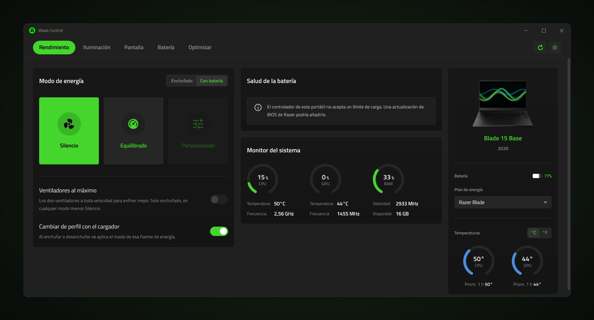
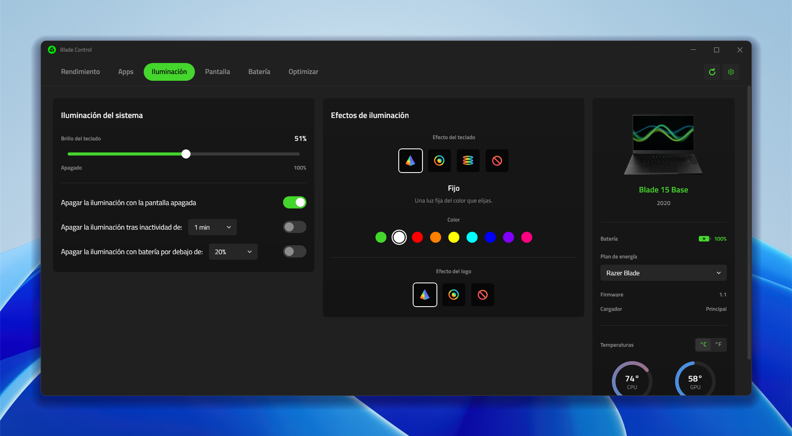
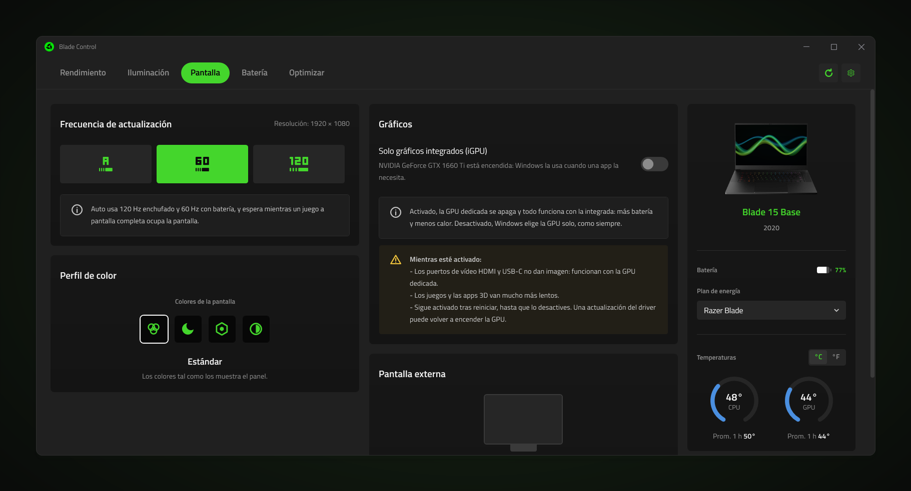
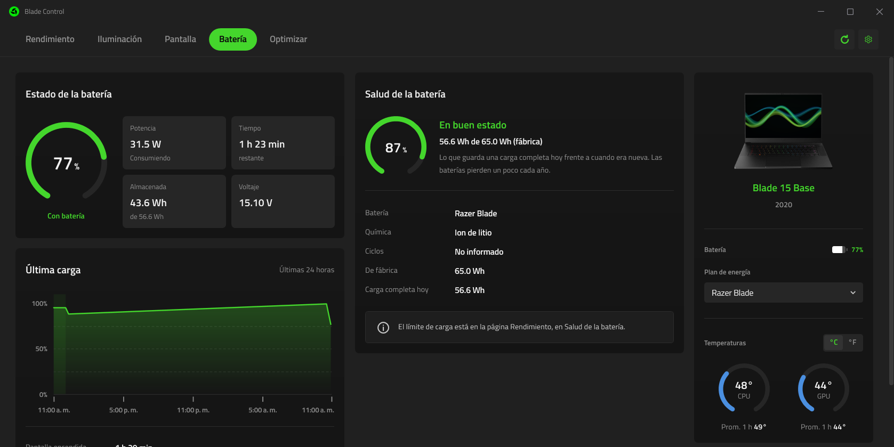
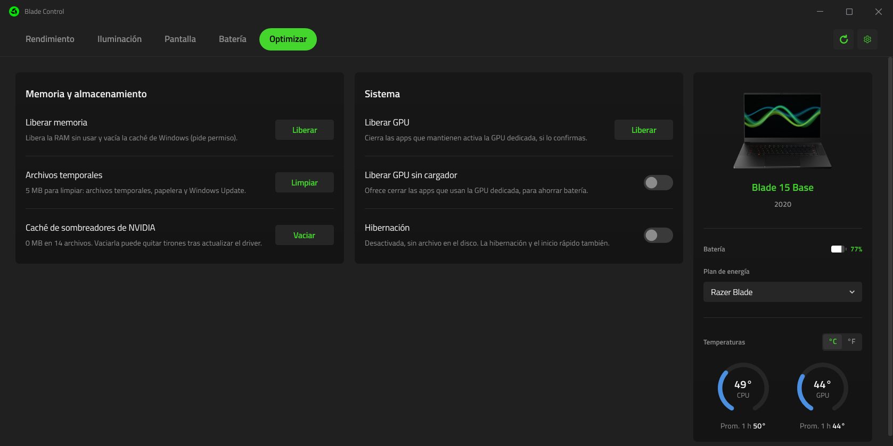
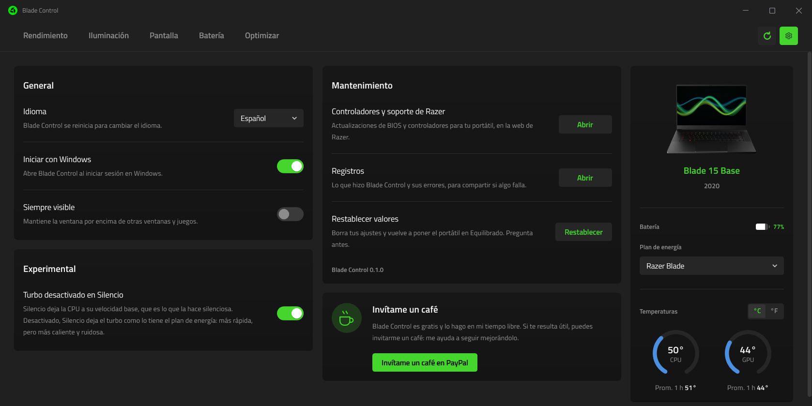

# Blade Control

[English](README.md) · **Español**

Un centro de control ligero para portátiles Razer Blade, en una ventana
completa de Windows. Cambia el modo de rendimiento, los ventiladores, la
iluminación del teclado, la pantalla y los ajustes de batería hablando
directamente con el controlador del portátil, sin Razer Synapse ni sus
servicios en segundo plano.



Blade Control nace de [Razer Helper](https://github.com/jdsgnrinfo/razer-helper),
una ventana emergente en la bandeja del sistema. Conserva su código de hardware
ya probado y lo lleva a una ventana redimensionable con el diseño de un centro
de control moderno: pestañas de páginas arriba, tarjetas para los ajustes y un
panel con la foto del portátil, la batería, el plan de energía y las
temperaturas.

## Funciones

- **Rendimiento**: Silencio, Equilibrado y Personalizado, con los niveles de
  CPU (Bajo a Turbo) y GPU (Bajo a Alto) de Personalizado. Cada fuente de
  energía guarda su propio modo, y al enchufar o desenchufar se cambia solo.
  Ventiladores al máximo, enchufado, en los modelos que lo tienen, y límite de
  carga de la batería (60 a 99 %) en los controladores que lo aceptan.
- **Silencio de verdad**: Silencio también apaga el turbo de la CPU de
  Windows, que es lo que hace silencioso a un Blade 15 Base (2020);
  Equilibrado y Personalizado lo devuelven. Un interruptor experimental en
  Ajustes lo desactiva.
- **Apps**: un perfil para cada juego o app (modo, ventiladores, frecuencia,
  colores de pantalla, iluminación del teclado y modo juego, que bloquea la
  tecla Windows y, si se elige, Alt+Tab y Alt+F4) que se aplica mientras está
  abierto y se deshace al cerrarlo, con un aviso. Encuentra solo los juegos
  instalados con Steam, Epic Games, Xbox y Battle.net.
- **Iluminación**: efectos, color y brillo del teclado y del logo, y el
  teclado que se apaga con la pantalla, por inactividad o con poca batería.
- **Pantalla**: la frecuencia de actualización de la pantalla interna (Auto
  sigue al cargador), un perfil de color (Estándar, Luz nocturna, Neutro,
  Contraste) que se mantiene al cerrar la app, si hay una pantalla externa
  conectada (con la opción de seguir funcionando con la tapa cerrada mientras
  lo está, enchufado) y *Solo gráficos integrados* (ver abajo).
- **Batería**: la carga, la potencia y el tiempo restante, las últimas 24
  horas según el informe de batería de Windows y la salud de la batería.
- **Optimizar**: liberar memoria, archivos temporales y la caché de shaders,
  las apps que mantienen despierta la GPU dedicada, la hibernación y el
  software de Razer.
- **Panel del portátil**: la foto y el modelo, la batería y los vatios que
  entran o salen (también al pasar el ratón por el icono de la bandeja), el
  plan de energía
  de Windows y las temperaturas de CPU y GPU (azul, que pasa a rojo por encima
  de 60 °C) con la media de la última hora.
- **Bandeja del sistema**: al cerrar la ventana la app sigue en la bandeja; un
  clic en su icono la abre otra vez y Salir en su menú la cierra. Puede
  iniciarse con Windows.
- **Atajos**, desde cualquier app o juego: **Fn+Supr** muestra u oculta la
  ventana, y **Ctrl+Shift+F1 / F2 / F3** cambian a Silencio, Equilibrado y
  Personalizado, con un pequeño aviso arriba a la derecha que nunca quita el
  foco. Los atajos de modo se pueden desactivar en Ajustes.
- **Tus ajustes en un archivo**: Ajustes exporta los modos, los perfiles de
  apps y las opciones a un archivo y los vuelve a importar, para reinstalar
  Windows o pasarlos a otro Blade. Lo que solo vale en este PC queda fuera.
- Inglés y español.

## Vista previa

| | |
| --- | --- |
|  |  |
| **Rendimiento** | **Iluminación** |
|  |  |
| **Pantalla** | **Batería** |
|  |  |
| **Optimizar** | **Ajustes** |

## Solo gráficos integrados

Un interruptor en la página Pantalla que apaga la GPU dedicada (NVIDIA), igual
que Deshabilitar en el Administrador de dispositivos, para que todo funcione
con la GPU integrada: más batería y menos calor. Pide permiso de
administrador y, antes de apagar la GPU, ofrece cerrar las apps que la usan.
Mientras esté activado:

- los puertos de vídeo HDMI y USB-C no dan imagen, porque están conectados a
  la GPU dedicada (el interruptor no se activa con una pantalla externa
  conectada);
- los juegos y las apps 3D van mucho más lentos;
- sigue activado tras reiniciar, hasta que se desactive. Una actualización del
  driver puede volver a encender la GPU.

No es un MUX: en los portátiles que no lo tienen, como el Blade 15 Base
(2020), la pantalla interna siempre la dibuja la GPU integrada.

## Portátiles compatibles

Probado en un **Razer Blade 15 Base (2020)**, un **Razer Blade 14 (2025)** y un
**Razer Blade 16 (2023)**.
Reconoce todos los Razer Blade desde 2021 (Blade 14, 15, 16, 17 y 18,
incluidos los modelos de 2025 y 2026). Usan los mismos comandos y deberían
funcionar; si el firmware de un portátil no tiene un comando, lo rechaza sin
más, y la app oculta o explica lo que no puede hacer.

## Descargar y usar

Blade Control es portable: no hay nada que instalar.

1. Genera la carpeta portable (ver abajo) o descárgala de una versión
   publicada.
2. Mantén los archivos juntos en una carpeta y abre `BladeControl.exe`.

Los ajustes y el registro se guardan en `%LOCALAPPDATA%\BladeControl`. Con
Iniciar con Windows activado, Windows abre el exe desde donde se abrió la
última vez, en la bandeja.

## Requisitos

- Windows 10 u 11 en un Razer Blade.
- La versión portable lleva .NET dentro. Para compilar desde el código hace
  falta el [SDK de .NET 10](https://dotnet.microsoft.com/download/dotnet/10.0).

## Compilar

```bash
dotnet build BladeControl.slnx
dotnet test tests/BladeControl.Core.Tests
dotnet run --project src/BladeControl
```

La carpeta portable: `BladeControl.exe`, que lleva .NET dentro, y a su lado
las pocas DLL nativas que necesita WPF, para no descomprimir nada en la
carpeta temporal.

```bash
dotnet publish src/BladeControl -c Release -p:Portable=true -o dist
```

`BladeControl.exe --screenshot archivo.png [página] [ancho]` dibuja la ventana
en una imagen unos segundos después de abrirse y luego se cierra; `página` es
Performance, Lighting, Display, Battery, Optimize o Settings. Las vistas
previas de arriba se hicieron así.

## Estructura

| Carpeta | Qué contiene |
| --- | --- |
| `src/BladeControl.Core` | Todo lo que habla con el portátil y con Windows: el EC por HID, los sensores, los planes de energía, los dispositivos, los ajustes, el registro y las traducciones. Sin interfaz. |
| `src/BladeControl` | La ventana WPF: temas, vistas y modelos de vista. |
| `tests/BladeControl.Core.Tests` | Las pruebas del núcleo, con un EC simulado para no tocar el portátil. |
| `docs` | Las vistas previas y notas de funciones retiradas (`docs/archive`). |

## Apoya el proyecto

Blade Control es gratis y lo hago en mi tiempo libre. Si te resulta útil,
puedes [invitarme un café en PayPal](https://paypal.me/jotica96). El mismo
enlace está en la app, en Ajustes.

## Créditos y licencia

MIT, ver [LICENSE](LICENSE). Hecho por Jotadsgnr. La idea viene de
[Razer Helper](https://github.com/Paulrod20/razer-helper) de Paul Rodriguez.
Titillium Web tiene licencia SIL Open Font License 1.1.

Blade Control no está hecho por Razer Inc. ni afiliado a ella. Razer y Blade
son marcas de Razer Inc. Cambia ajustes del controlador del portátil y
dispositivos de Windows; úsalo bajo tu propia responsabilidad.
