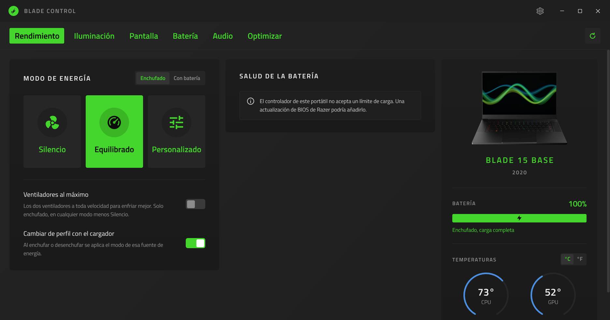

# Blade Control

A light control center for Razer Blade laptops, in a full Windows window. It
changes the performance mode, Custom's CPU and GPU levels, max fan speed and
the battery charge limit straight through the laptop's controller, without
Razer Synapse or its background services.



Blade Control grew out of [Razer Helper](https://github.com/jdsgnrinfo/razer-helper),
a tray popup. It keeps Razer Helper's tested hardware code and moves it into
a resizable window laid out like a modern control center: sections along the
title bar, green page tabs, cards for the settings, and a panel with the
laptop's picture, battery and temperatures.

## What works today

- **Performance**: Silent, Balanced and Custom, with Custom's CPU (Low to
  Boost) and GPU (Low to High) levels. Each power source keeps its own mode,
  and plugging in or unplugging switches between them.
- **Silent really is quiet**: Silent also turns Windows' CPU boost off, which
  is what quiets a Blade 15 Base (2020); Balanced and Custom give it back.
- **Max fan speed**, plugged in, on the models that have it.
- **Battery charge limit** (60 to 99%), on controllers that accept one.
- **Device panel**: the laptop's picture and model, battery, CPU and GPU
  temperatures (blue, turning red past 60 °C) with the last hour's average,
  and fan speeds where the controller reports them.
- **Lighting**: keyboard and logo effects, color and brightness, and the
  keyboard going dark with the screen, when idle or on low battery.
- **Display**: the internal screen's refresh rate (Auto follows the charger)
  and a color profile that stays on after the app closes.
- **Battery**: the charge, power and time left, the last 24 hours from
  Windows' own battery report, and the battery's health.
- **Audio** *(in testing)*: the output device and a ten-band equalizer, from
  +6 to -6 dB, with presets. See [Audio](#audio-in-testing) for what it needs.
- **Optimize**: freeing memory, temporary files and the shader cache, the
  dedicated GPU, hibernation, and Razer's own software.
- English and Spanish, following Windows or the saved setting.

Closing the window keeps it in the tray; a click on its icon opens it again,
and Exit in the icon's menu ends it.

## Audio (in testing)

The equalizer is still being tried out. Blade Control does not process sound
itself: it writes the curves into [Equalizer APO](https://sourceforge.net/projects/equalizerapo/),
which does. For it to work:

1. Install Equalizer APO (the Audio page links to it while it is missing).
2. In its Device Selector, which the installer opens, tick every output
   device the equalizer should work on, then restart Windows.
3. Open Audio in Blade Control: each device keeps its own curve, which plays
   as soon as it changes.

A device added later, such as new Bluetooth headphones, has to be ticked
once the same way: the Audio page says so and opens the Device Selector.
Blade Control writes Equalizer APO's `config.txt`; the file it found there
the first time is kept beside it as `config.before-BladeControl.txt`.

## Requirements

- Windows 10 or 11 on a Razer Blade.
- The [.NET 10 Desktop Runtime](https://dotnet.microsoft.com/download/dotnet/10.0) (or newer), except
  for the portable build, which carries .NET inside it.

## Building

```bash
dotnet build BladeControl.slnx
dotnet test tests/BladeControl.Core.Tests
dotnet run --project src/BladeControl
```

`BladeControl.exe --screenshot file.png [page]` draws the window into a
picture a few seconds after it opens, then closes; `page` is one of
Performance, Lighting, Display, Battery, Audio, Optimize or Settings.

## Portable build

One `BladeControl.exe` that runs from any folder, with nothing to install:

```bash
dotnet publish src/BladeControl -c Release -p:Portable=true -o dist
```

The settings and the log stay in `%LOCALAPPDATA%\BladeControl`. With Start at
login on, Windows starts the exe from wherever it was last opened, in the tray.

## Layout

| Folder | What it holds |
| --- | --- |
| `src/BladeControl.Core` | Everything that talks to the laptop and Windows: the EC over HID, sensors, power plans, settings, the log and the translations. No interface. |
| `src/BladeControl` | The WPF window: themes, views and view models. |
| `tests/BladeControl.Core.Tests` | The tests for the core, with a scripted EC so nothing touches the laptop. |

Settings live in `%LOCALAPPDATA%\BladeControl\settings.json` and the log in
`%LOCALAPPDATA%\BladeControl\bladecontrol.log`.

## Credits and license

MIT, see [LICENSE](LICENSE). Based on Razer Helper by Paul Rodriguez and
jdsgnrinfo. Titillium Web is under the SIL Open Font License 1.1.

Blade Control is not made by or affiliated with Razer Inc. Razer and Blade
are trademarks of Razer Inc.
