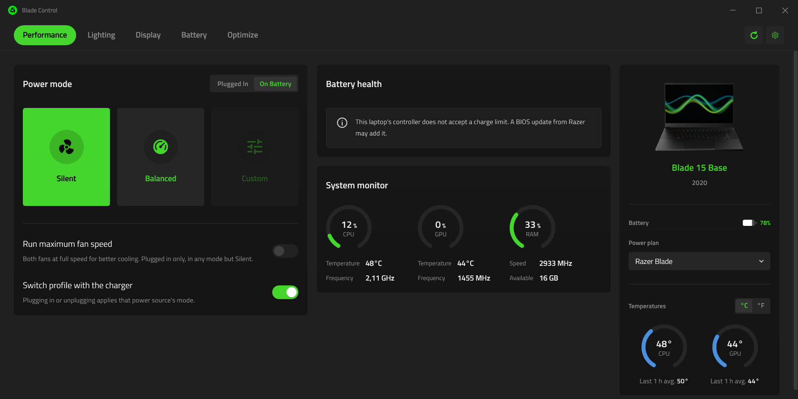
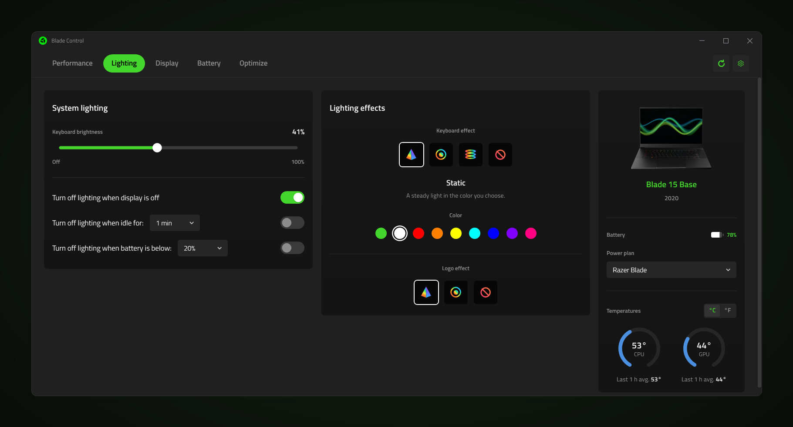
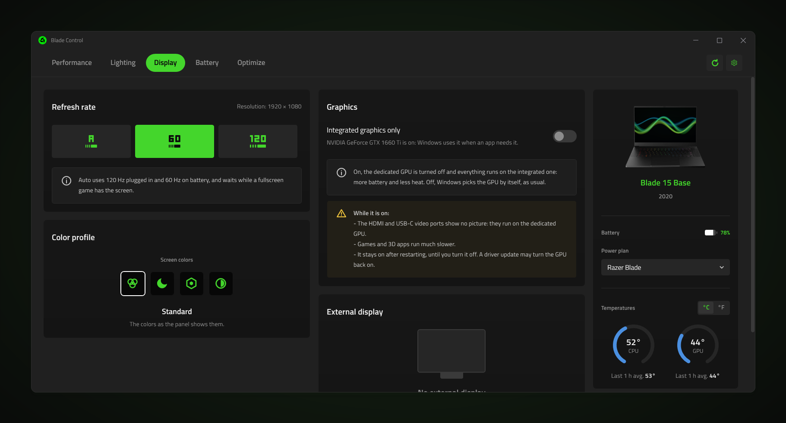
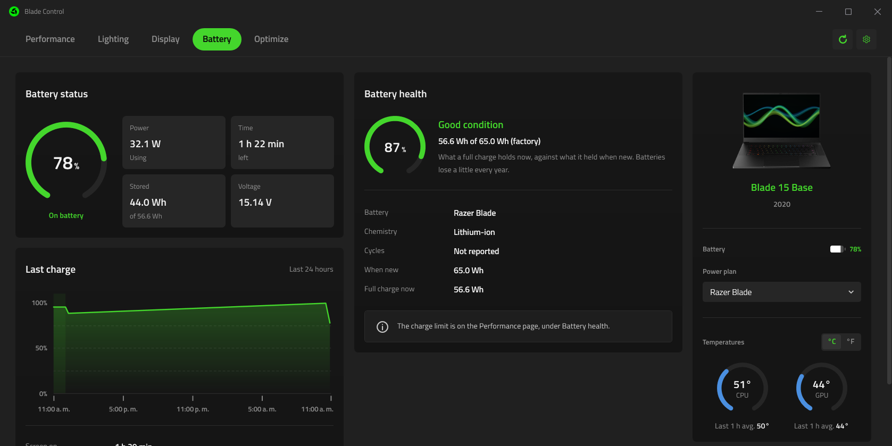
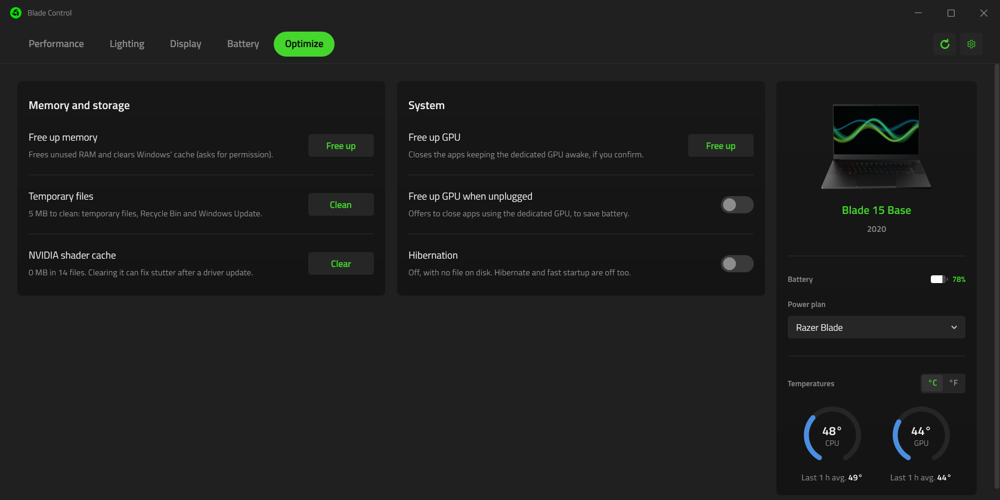
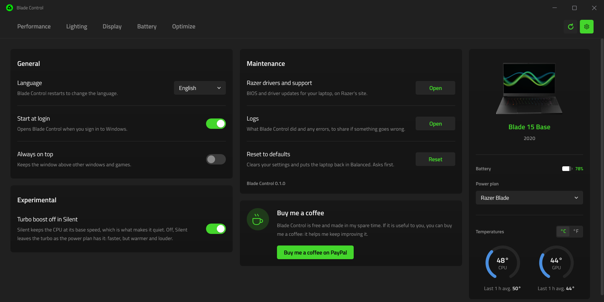

# Blade Control

**English** · [Español](README.es.md)

A light control center for Razer Blade laptops, in a full Windows window. It
changes the performance mode, the fans, the keyboard lighting, the screen and
the battery settings straight through the laptop's controller, without Razer
Synapse or its background services.



Blade Control grew out of [Razer Helper](https://github.com/jdsgnrinfo/razer-helper),
a tray popup. It keeps Razer Helper's tested hardware code and moves it into a
resizable window laid out like a modern control center: page tabs along the
top, cards for the settings, and a panel with the laptop's picture, battery,
power plan and temperatures.

## Features

- **Performance**: Silent, Balanced and Custom, with Custom's CPU (Low to
  Boost) and GPU (Low to High) levels. Each power source keeps its own mode,
  and plugging in or unplugging switches between them. Max fan speed, plugged
  in, on the models that have it, and the battery charge limit (60 to 99%) on
  controllers that accept one.
- **Silent really is quiet**: Silent also turns Windows' CPU boost off, which
  is what quiets a Blade 15 Base (2020); Balanced and Custom give it back.
  An experimental switch in Settings turns this off.
- **Apps**: a profile for each game or app (mode, fans, refresh rate, screen
  colors and keyboard lighting) that goes on while it runs and is undone when
  it closes, with a notice. Games installed with Steam, Epic Games, Xbox and
  Battle.net are found for you.
- **Lighting**: keyboard and logo effects, color and brightness, and the
  keyboard going dark with the screen, when idle or on low battery. Game
  mode blocks the Windows key (and Alt+Tab or Alt+F4, if chosen), by hand or
  while a game with an app profile runs.
- **Display**: the internal screen's refresh rate (Auto follows the charger),
  a color profile (Standard, Night light, Neutral, Contrast) that stays on
  after the app closes, whether an external display is connected (and an
  option to keep running with the lid closed while one is, plugged in), and
  *Integrated graphics only* (see below).
- **Battery**: the charge, power and time left, the last 24 hours from
  Windows' own battery report, and the battery's health.
- **Optimize**: freeing memory, temporary files and the shader cache, the
  apps keeping the dedicated GPU awake, hibernation, and Razer's own software.
- **Device panel**: the laptop's picture and model, battery and the watts
  going in or out (also on the tray icon's hover), Windows' power
  plan, and CPU and GPU temperatures (blue, turning red past 60 °C) with the
  last hour's average.
- **Tray**: closing the window keeps the app in the tray; a click on its icon
  opens it again, and Exit in its menu ends it. It can start with Windows.
- **Shortcuts**, from any app or game: **Fn+Del** shows or hides the window,
  and **Ctrl+Shift+F1 / F2 / F3** switch to Silent, Balanced and Custom, with a
  small notice at the top right that never takes the focus. The mode
  shortcuts can be turned off in Settings.
- **Your settings in a file**: Settings exports the modes, app profiles and
  options to a file and imports them back, for a Windows reinstall or another
  Blade. What only applies to this PC stays out.
- English and Spanish.

## Preview

| | |
| --- | --- |
|  |  |
| **Performance** | **Lighting** |
|  |  |
| **Display** | **Battery** |
|  |  |
| **Optimize** | **Settings** |

## Integrated graphics only

A switch on the Display page that turns the dedicated (NVIDIA) GPU off, as
Device Manager's Disable does, so everything runs on the integrated GPU: more
battery and less heat. It asks for administrator permission, and before
turning the GPU off it offers to close the apps using it. While it is on:

- the HDMI and USB-C video ports show no picture, since they are wired to the
  dedicated GPU (the switch will not turn on with an external display
  connected);
- games and 3D apps run much slower;
- it stays on after restarting, until it is turned off. A driver update may
  turn the GPU back on.

This is not a MUX switch: on laptops without one, such as the Blade 15 Base
(2020), the internal screen is always driven by the integrated GPU.

## Supported laptops

Verified on a **Razer Blade 15 Base (2020)**, a **Razer Blade 14 (2025)** and a
**Razer Blade 16 (2023)**.
Every Razer Blade from 2021 on is recognized (Blade 14, 15, 16, 17 and 18,
including the 2025 and 2026 models). They use the same commands and are
expected to work; a command a laptop's firmware does not have is refused
cleanly, and the app hides or explains what it cannot do.

## Download and run

Blade Control is a portable app: nothing to install.

1. Build the portable folder (see below) or take it from a release.
2. Keep the files together in one folder and open `BladeControl.exe`.

The settings and the log live in `%LOCALAPPDATA%\BladeControl`. With Start at
login on, Windows starts the exe from wherever it was last opened, in the tray.

## Requirements

- Windows 10 or 11 on a Razer Blade.
- The portable build carries .NET inside it. Building from source needs the
  [.NET 10 SDK](https://dotnet.microsoft.com/download/dotnet/10.0).

## Building

```bash
dotnet build BladeControl.slnx
dotnet test tests/BladeControl.Core.Tests
dotnet run --project src/BladeControl
```

The portable folder: `BladeControl.exe`, which carries .NET inside it, and
beside it the few native DLLs WPF needs, so nothing is unpacked into the
temporary folder.

```bash
dotnet publish src/BladeControl -c Release -p:Portable=true -o dist
```

`BladeControl.exe --screenshot file.png [page] [width]` draws the window into a
picture a few seconds after it opens, then closes; `page` is one of
Performance, Lighting, Display, Battery, Optimize or Settings. The previews
above were made this way.

## Layout

| Folder | What it holds |
| --- | --- |
| `src/BladeControl.Core` | Everything that talks to the laptop and Windows: the EC over HID, sensors, power plans, devices, settings, the log and the translations. No interface. |
| `src/BladeControl` | The WPF window: themes, views and view models. |
| `tests/BladeControl.Core.Tests` | The tests for the core, with a scripted EC so nothing touches the laptop. |
| `docs` | The previews, and notes on features taken out (`docs/archive`). |

## Support the project

Blade Control is free and made in spare time. If it is useful to you, you can
[buy me a coffee on PayPal](https://paypal.me/jotica96). The same link is in
the app, under Settings.

## Credits and license

MIT, see [LICENSE](LICENSE). Made by Jotadsgnr. The idea comes from
[Razer Helper](https://github.com/Paulrod20/razer-helper) by Paul Rodriguez.
Titillium Web is under the SIL Open Font License 1.1.

Blade Control is not made by or affiliated with Razer Inc. Razer and Blade are
trademarks of Razer Inc. It changes the laptop's controller settings and
Windows devices; use it at your own risk.
